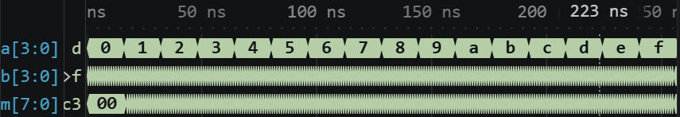
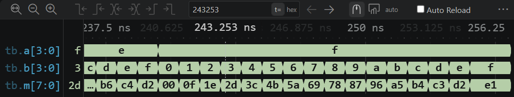

# 실험 전 레포트: STM32_0 FPGA 실습 ① · 4비트 곱셈기

작성자: 박건우 (2025440050) / 작성일: 2026-10-09 / 소스 커밋: [65c0e73](https://github.com/bandnewbie/UOS_ECE_project4/commit/65c0e732cf25f745889f9103801a15bdc25849e7) / workspace: `lab4_01_mult_4bit/FPGA.code-workspace` / OS: Windows / 시뮬레이터 버전: Icarus Verilog 12.0 (devel) (s20150603-1539-g2693dd32b)

## 목적과 예상 동작

두 4비트 무부호 입력 `a`, `b`를 곱해 8비트 결과 `m`을 낸다 [1]. 최댓값끼리 곱해도 15×15 = 225 = 1110_0001₂로 8비트 안에 들어간다. 곱셈은 부분곱을 더하는 조합회로이며 클록이 없다 [2].

## 소스와 테스트벤치

- 설계 top: `mult_4bit` / 시뮬레이션 top: `tb`
- RTL: [multiply_unsigned.v](../../lab4_01_mult_4bit/src/multiply_unsigned.v), [mult_4bit.v](../../lab4_01_mult_4bit/src/mult_4bit.v)
- TB: [tb.sv](../../lab4_01_mult_4bit/sim/tb.sv)
- XDC: 교안에 포함되지 않음. 장비 교재의 핀 설명에 따라 작성한다 [1].
- 기대 PASS: `PASS multiplier: 256 input pairs`

TB는 `a`, `b`의 256개 조합을 1 ns마다 넣고 `m !== a*b`이면 `$fatal`로 종료한다 [1]. VS Code의 02 Simulate가 wave.vcd를 요구해서 교안 TB에 `$dumpfile`·`$dumpvars` 두 줄만 추가했다.

## VS Code 실행 과정

Run Task 01 Check tools → 02 Simulate → 03 Open waveform 순서로 실행했다. 02 Simulate 결과 `PASS multiplier: 256 input pairs`가 출력되고 256 ns에 종료했다.

- PASS 로그: [simulation.txt](../../evidence/01/vscode/simulation.txt)
- 파형: [wave.vcd](../../evidence/01/vscode/wave.vcd)

| 시간 구간 | 입력 | 예상 | 실제 파형 (16진수) | 해석 |
|---|---|---|---|---|
| 0–256 ns | a 0→15 (16 ns마다), b 0→15 (1 ns마다) | m = a×b | a 0→f, b 반복 | 256개 조합 |
| 240–256 ns | a=15, b=0→15 | 0, 15, 30 … 225 | m 00, 0f, 1e … d2, e1 | 15×b와 일치 |
| 256 ns | — | PASS | $finish 256 ns | 256개 모두 통과 |

## 보드 실험 계획

교재의 핀 설명에 따라 `a`, `b`를 입력 스위치, `m`을 LED 8개에 연결한다. 3×5 = 0000_1111₂, 15×15 = 1110_0001₂가 표시되는지 확인하고 시뮬레이션과 비교한다 [1].

## 참고문헌

[1] 이해리, "STM32 실습 매뉴얼(STM32_0 · LED와 버튼, FPGA 추가 실습)" 및 "STM32 실습 안내", 서울시립대학교 전자전기컴퓨터설계실험Ⅱ, GitHub Glaysia/ece2_474 v1.1.0, 2026.

[2] D. M. Harris and S. L. Harris, *Digital Design and Computer Architecture: ARM Edition*, Morgan Kaufmann, 2015. ISBN 978-0-12-800056-4.
