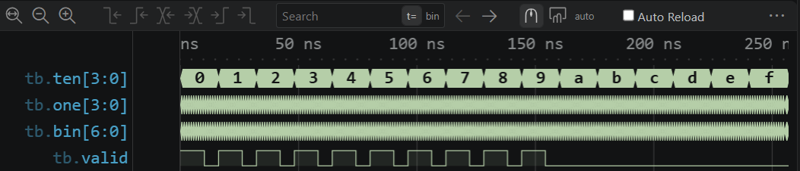
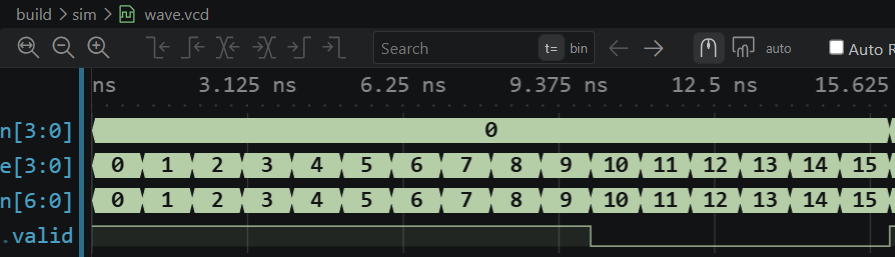

# 실험 전 레포트: STM32_0 FPGA 실습 ② · BCD → 이진수 변환

작성자: 박건우 (2025440050) / 작성일: 2026-10-09 / 소스 커밋: [65c0e73](https://github.com/bandnewbie/UOS_ECE_project4/commit/65c0e732cf25f745889f9103801a15bdc25849e7) / workspace: `lab4_02_bcd_conv/FPGA.code-workspace` / OS: Windows / 시뮬레이터 버전: Icarus Verilog 12.0 (devel) (s20150603-1539-g2693dd32b)

## 목적과 예상 동작

십의 자리 `ten`과 일의 자리 `one`을 받아 `bin = ten×10 + one`(7비트, 최대 99 = 110_0011₂)을 낸다. 교재 원본에 `valid` 출력이 추가되어 두 자리가 모두 0~9일 때만 1이다 [1]. 범위를 벗어난 입력에서도 계산값은 나오지만 `valid`=0이다.

## 소스와 테스트벤치

- 설계 top: `bcd_conv` / 시뮬레이션 top: `tb`
- RTL: [bcd_to_binary.v](../../lab4_02_bcd_conv/src/bcd_to_binary.v), [bcd_conv.v](../../lab4_02_bcd_conv/src/bcd_conv.v)
- TB: [tb.sv](../../lab4_02_bcd_conv/sim/tb.sv)
- XDC: 교안에 포함되지 않음. 장비 교재의 핀 설명에 따라 작성한다 [1].
- 기대 PASS: `PASS BCD: 100 valid and 156 invalid inputs`

TB는 256개 조합을 1 ns마다 넣고 모든 경우의 `valid`와 유효한 경우의 `bin`을 검사한다 [1]. 교안 TB에 `$dumpfile`·`$dumpvars` 두 줄만 추가했다.

## VS Code 실행 과정

Run Task 01 Check tools → 02 Simulate → 03 Open waveform 순서로 실행했다. 02 Simulate 결과 `PASS BCD: 100 valid and 156 invalid inputs`가 출력되고 256 ns에 종료했다.

- PASS 로그: [simulation.txt](../../evidence/02/vscode/simulation.txt)
- 파형: [wave.vcd](../../evidence/02/vscode/wave.vcd)

| 시간 구간 | 입력 | 예상 | 실제 파형 | 해석 |
|---|---|---|---|---|
| 0–10 ns | ten=0, one=0→9 | bin 0~9, valid 1 | bin 0~9, valid 1 | 유효한 BCD |
| 10–16 ns | ten=0, one=10→15 | valid 0 | bin 10~15, valid 0 | 일의 자리 범위 밖 |
| 16–160 ns | ten=1→9 | 16 ns마다 valid 10 ns 1, 6 ns 0 | 같은 패턴 반복 | 자리마다 one=10~15 구간 무효 |
| 160–256 ns | ten=10→15 | valid 0 | valid 계속 0 | 십의 자리 범위 밖 |

## 보드 실험 계획

교재의 핀 설명에 따라 `ten`, `one`을 입력 스위치, `bin`과 `valid`를 LED에 연결한다. 4·2 → 42 = 010_1010₂와 valid=1, 일의 자리 12 → valid=0을 확인한다 [1].

## 참고문헌

[1] 이해리, "STM32 실습 매뉴얼(STM32_0 · LED와 버튼, FPGA 추가 실습)" 및 "STM32 실습 안내", 서울시립대학교 전자전기컴퓨터설계실험Ⅱ, GitHub Glaysia/ece2_474 v1.1.0, 2026.

[2] D. M. Harris and S. L. Harris, *Digital Design and Computer Architecture: ARM Edition*, Morgan Kaufmann, 2015. ISBN 978-0-12-800056-4.
